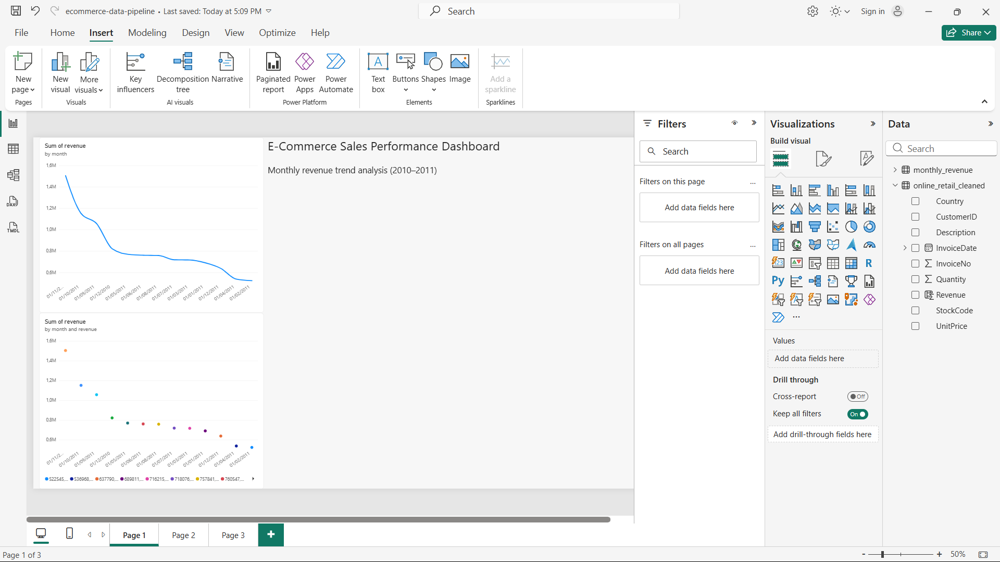
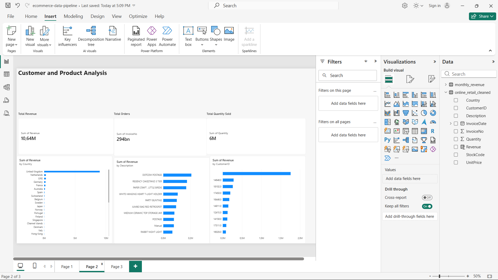
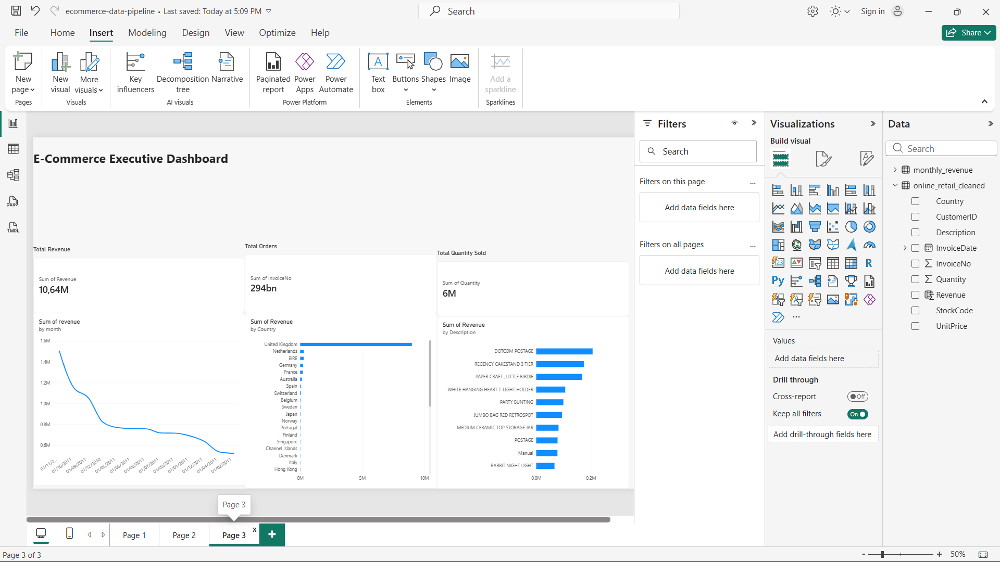

# E-Commerce Data Pipeline & Analytics

An end-to-end data analytics project that transforms raw e-commerce transaction data into structured, queryable data and business insights.

## Project Overview

This project uses the UCI Online Retail dataset to demonstrate a practical data workflow, from data exploration and cleaning to database storage, SQL analytics, and Power BI visualization.

The goal is to turn raw transaction records into useful information about revenue, products, customers, and country-level sales.

## Pipeline Architecture

Raw Excel Data → Python & Pandas → Data Cleaning → SQLite Database → SQL Analytics → CSV Exports → Power BI Dashboard

## Technologies Used

- **Python** — data processing and automation
- **Pandas** — data loading, cleaning, and transformation
- **SQLite** — relational database storage
- **SQL** — aggregation and business analysis
- **Jupyter Notebook** — exploratory data analysis
- **Power BI** — dashboard development
- **Git & GitHub** — version control and project documentation

## Project Structure

```text
ecommerce-data-pipeline/
├── dashboard/
│   └── data/
├── data/
│   └── processed/
├── notebooks/
├── sql/
├── src/
│   ├── inspect_data.py
│   ├── load_to_database.py
│   ├── run_query.py
│   ├── verify_database.py
│   └── export_dashboard_data.py
├── tests/
├── .gitignore
├── 01_data_exploration.ipynb
├── requirements.txt
└── README.md
```

## Key Features

- Explores raw e-commerce transaction data using Python.
- Processes cleaned transaction data for analysis.
- Loads transactions into an SQLite database.
- Verifies database contents with SQL queries.
- Calculates revenue, average prices, and quantities sold.
- Identifies top products and customers by revenue.
- Analyzes sales by month and country.
- Exports six analytical datasets for Power BI.

## Database

The SQLite database contains a `transactions` table.

The current database verification returned **524,878 rows**.

## Business Questions

The project explores questions such as:

- How does revenue change over time?
- Which countries generate the most revenue?
- Which products generate the highest revenue?
- Which products sell the most units?
- Which customers contribute the most revenue?
- How many orders come from each country?


## Power BI Dashboard

The interactive Power BI report contains three pages covering sales performance, customer and product analysis, and executive-level KPIs.

### 1. E-Commerce Sales Performance Dashboard



### 2. Customer and Product Analysis



### 3. E-Commerce Executive Dashboard




## How to Run

### 1. Set up the environment

```bash
python -m venv .venv
```

Activate it on Windows:

```powershell
.\.venv\Scripts\Activate.ps1
```

### 2. Install dependencies

```bash
pip install -r requirements.txt
```

### 3. Run the scripts

Run commands from the project root directory:

```powershell
python src/inspect_data.py
python src/load_to_database.py
python src/verify_database.py
python src/run_query.py
python src/export_dashboard_data.py
```

**Note:** The loading script expects the cleaned CSV at `data/processed/online_retail_cleaned.csv`. The inspection script expects the original Excel file at `data/raw/Online Retail.xlsx`. These input files are not included automatically.

## Future Improvements

- Add automated data validation and unit tests.
- Improve error handling and logging.
- Build a repeatable ETL workflow.
- Document SQL transformations.
- Add dashboard screenshots and business findings.

## Author

Computer Science undergraduate interested in data engineering, business intelligence, and analytics.
